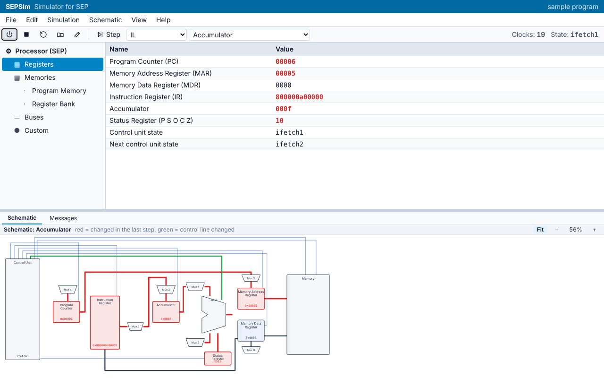
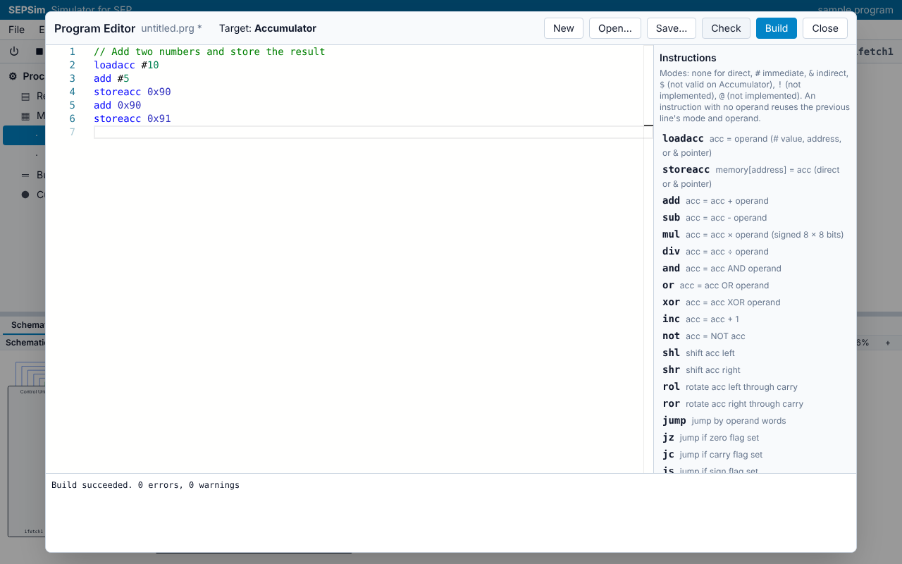
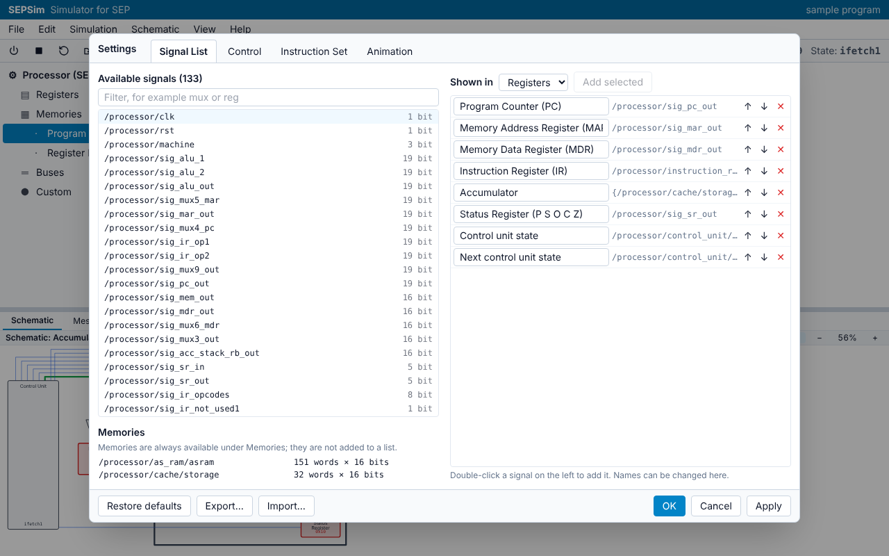
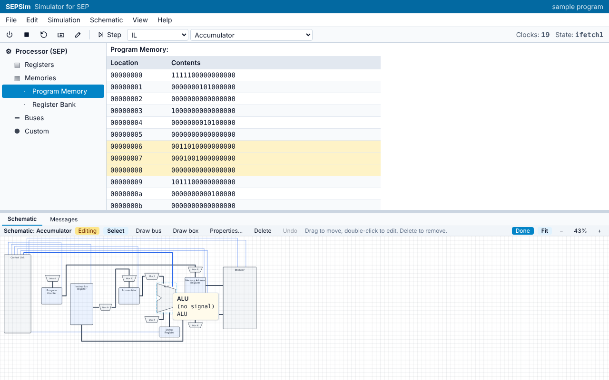
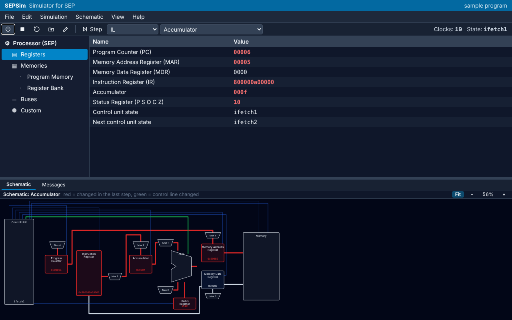

# sepsim
A modern, cross-platform desktop rebuild of the SEPSim microprocessor simulator. Built with Tauri and React to completely eliminate the need for legacy Windows XP virtual machines.



It works completely offline and runs on Windows 7, 8, 10 and 11, on both 32-bit and
64-bit PCs. This version supports the **Accumulator** architecture.

## Screenshots

| Program Editor | Settings |
| --- | --- |
|  |  |
| **Diagram editor** | **Dark mode** |
|  |  |

## Download and install

1. Open [Desktop installers](https://github.com/kavishkashehan726-sudo/sepsim/actions/workflows/desktop.yml)
   (sign in to GitHub), click the newest run on `main`, and scroll down to **Artifacts**.
   Once a version is released, the installers are also on the **Releases** page.
2. Pick the one for the PC. Each download is a zip with the setup file inside.

   | Download | For |
   | --- | --- |
   | `SEPSim-Windows-10-11-64-bit` | Windows 10 and 11, 64-bit (most PCs) |
   | `SEPSim-Windows-10-11-32-bit` | Windows 10, 32-bit |
   | `SEPSim-Windows-7-8` | Windows 7, 8 and 8.1, 32-bit or 64-bit |

   Not sure which? Press Windows + Pause (or open **Settings > System > About**) and look at
   "System type". Use the Windows 7/8 installer only on Windows 7 and 8.
3. Run the setup file. The installers are not code-signed yet, so Windows may show
   "Windows protected your PC": click **More info**, then **Run anyway**.
4. No internet is needed, during installation or afterwards. The Windows 10/11 installers
   include Microsoft WebView2 and install it only if the PC does not already have it.

## Try it in five minutes

Use this checklist to test a new installer on a lab PC.

1. **Start it.** Open SEPSim from the Start menu. The main window shows the processor's
   registers, and the schematic of the Accumulator datapath below them.
2. **Run the sample program.** Click the first toolbar button (or **Simulation >
   Initialize**). Press **F10** to step. In **RTL** mode each step is one clock; switch the
   mode box to **IL** and each step is one instruction. Values that changed turn red, in the
   table and on the schematic. After three IL steps the Accumulator holds `000f`. Under
   **Program Memory** a red arrow points at the next instruction. When the program ends,
   stepping stops and the **Messages** tab says "End of program" (SEP has no halt
   instruction; **Edit > Settings > Control** can let it run on, like the original).
3. **Look inside.** Click **Program Memory** or **Buses** on the left. Right-click a table to
   switch between binary, decimal and hexadecimal. Hover over the schematic to see a value
   in binary. Double-click a table to open it in its own window.
4. **Change a value.** While the simulation runs, click the Accumulator's value, type `0x20`
   and press Enter. The **Messages** tab records the change.
5. **Write a program.** Open **File > Program Editor**, type for example:

   ```
   loadacc #10
   add #5
   storeacc 0x90
   ```

   Click **Check**: mistakes are underlined with the line number in the output. Click
   **Build**: it saves the `.prg` and `.mem` files and loads the program. Step through it
   with F10, then check address `0x90` under **Program Memory**.
6. **Load a program.** **Simulation > Load Program…** opens any `.mem` file, including ones
   made by the old SEPSim.
7. **Settings.** **Edit > Settings…** changes which signals each list shows, the clock, and
   the instruction set. Add a signal to **Custom** and click OK.
8. **Schematic.** **Schematic > Edit Current** lets you draw: pick **Draw box**, click two
   corners, and name it. **Schematic > Save As…** saves a `.dia` file, and **Load…** opens old
   SEPSim diagrams too.
9. **Restart the app.** Close and reopen SEPSim: your settings and diagram are still there.

If something does not work, open an
[issue](https://github.com/kavishkashehan726-sudo/sepsim/issues) with the Windows version,
32- or 64-bit, which installer you used, and a screenshot of the **Messages** tab.

## Golden traces

`tests/golden` is a submodule pointing at a **private** repo of recordings from the
original SEP model (ModelSim, Windows XP VM). The new engine is tested against them.
With access to that repo, fetch it with:

```
git submodule update --init
```

Without access the folder stays empty; everything else still works.

## Working on it

```
npm install
npm run dev        # the app in a browser at http://localhost:5173
npm test           # engine tests (parity tests need tests/golden)
npm run build      # the app, built for Chromium 108 and later
```

- `packages/sep-core`: the SEP processor model, assembler and file formats (no UI).
- `packages/sep-app`: the user interface (React, Tailwind, Monaco bundled locally so it
  works offline).
- `desktop/tauri`: the Windows 10/11 app (Tauri, using the WebView2 built into Windows).
- `desktop/electron`: the Windows 7/8 app (Electron 22, the last Electron that runs there).

## Windows installers

GitHub Actions builds them on every push (see the **Desktop installers** workflow; the
installers are attached to each run). Pushing a tag such as `v0.1.0` also makes a draft
release with them.

| Installer | For | Notes |
| --- | --- | --- |
| `SEPSim-<version>-Windows-10-11-64-bit-Setup.exe` | Windows 10 and 11, 64-bit | Includes WebView2, so it installs offline |
| `SEPSim-<version>-Windows-10-11-32-bit-Setup.exe` | Windows 10, 32-bit | Includes WebView2, so it installs offline |
| `SEPSim-<version>-Windows-7-8-Setup.exe` | Windows 7, 8 and 8.1, 32- and 64-bit | Picks the right build itself |

To build them yourself on Windows:

```
npm install
cd desktop/tauri && npm install && npm run dist              # Windows 10/11
cd desktop/electron && npm install && npm run dist           # Windows 7/8
```

The Tauri build needs Rust and the Visual Studio C++ build tools
(see https://tauri.app/start/prerequisites/). For a 32-bit build, add
`-- --target i686-pc-windows-msvc` after `npm run dist`.
